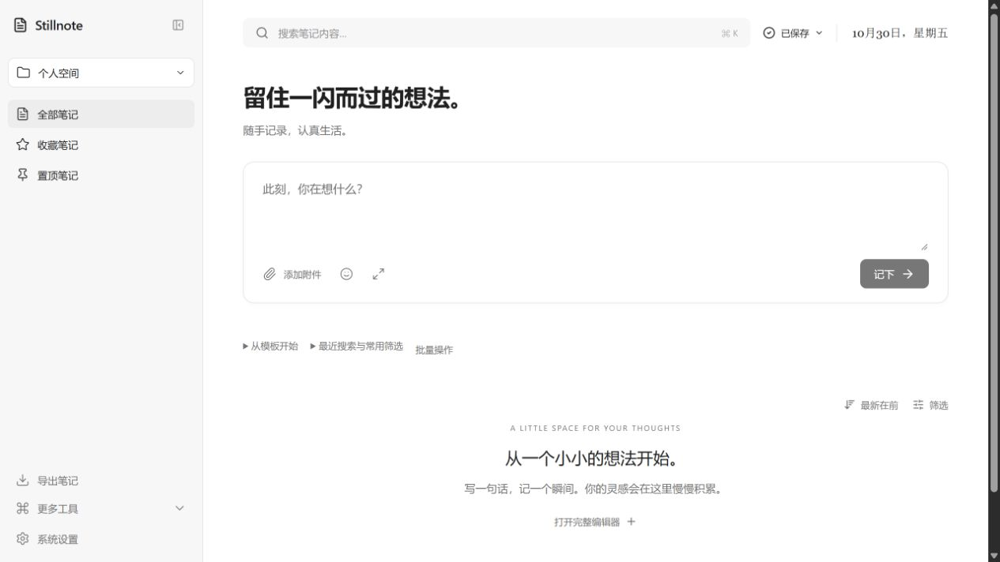
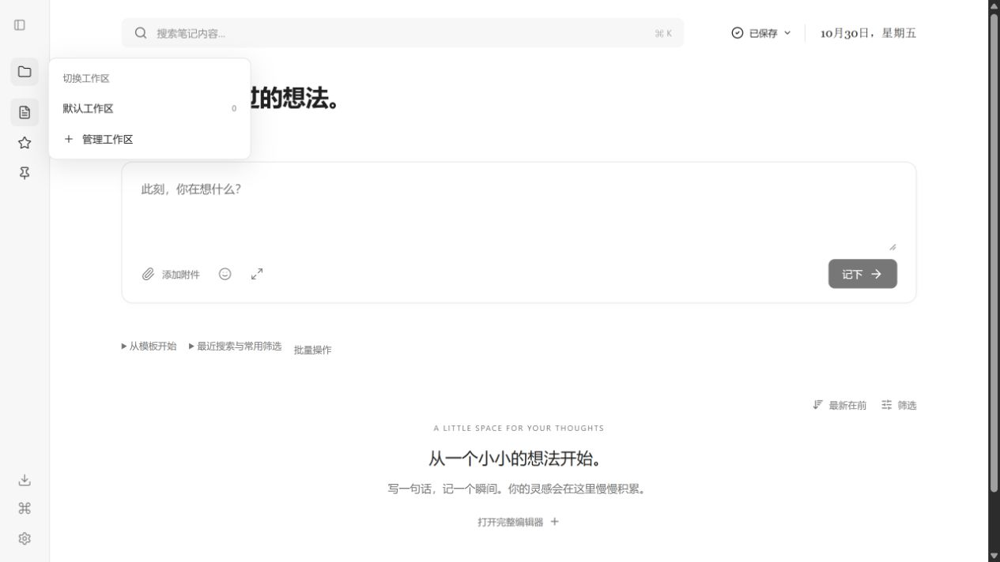
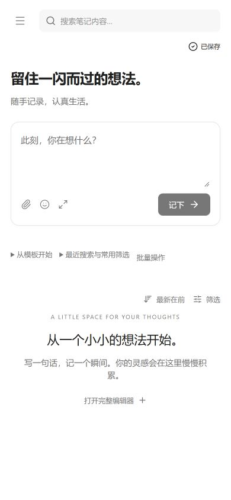

<div align="center">

<h1>Stillnote</h1>
<p><strong>留住一闪而过的想法。</strong></p>
<p>A quiet, local-first Markdown notebook.</p>
<p><a href="https://stillnote-crazyer.vercel.app">在线使用</a> · <a href="https://github.com/Crazyer-Flove/Stillnote/releases/latest">下载 Windows 版</a> · <a href="docs/user-guide.md">使用指南</a> · <a href="docs/development.md">开发与打包</a></p>

</div>

Stillnote（原 FloveNote）是一款本地优先的 Markdown 笔记工具。无需注册账号，在克制的中性色界面记录想法，用工作区整理，再导出为 Markdown、图片或 PDF。界面语言为中文。



## 下载与开始

在 [Releases](https://github.com/Crazyer-Flove/Stillnote/releases/latest) 下载 Windows 10/11 x64 版本：

| 文件 | 使用方式 |
| --- | --- |
| `Stillnote-1.3.0-Windows-x64-Portable.exe` | 双击直接运行，首次解压运行时可能稍慢 |
| `Stillnote-1.3.0-Windows-x64-Setup.exe` | 当前用户安装，支持选择安装位置与开始菜单入口 |
| `SHA256SUMS.txt` | 核对下载文件 SHA-256 |

桌面快捷方式在「系统设置 → 外观 → 创建桌面快捷方式」主动创建。便携版移动位置后，请重新创建快捷方式。当前 EXE 未签名，请从本仓库下载并核验来源。

```powershell
Get-FileHash .\Stillnote-1.3.0-Windows-x64-Portable.exe -Algorithm SHA256
```

## 1.3.0 界面更新

参考 Codex 的紧凑侧栏和中性色层次，统一导航、标题、输入区与按钮。折叠时顶部只保留展开按钮，工作区和工具菜单使用独立弹层，随窗口边缘避让，不再被侧栏裁切；点击外部或 Esc 可关闭。

## 使用方式

- **工作区**：首次使用只有默认工作区；左侧工作区菜单进入管理，可以创建和删除。默认工作区不能删除；删除其他工作区时，其中笔记和回收站记录移入默认工作区，磁盘文件保留。
- **目录**：在「系统设置 → 文件夹存储」选择一个根文件夹。Windows 使用原生选择器显示实际路径，并在重启后记住选择；网页使用浏览器授权，不提供任意磁盘绝对路径访问。
- **分类**：使用工作区、收藏和置顶。标签功能已移除；旧笔记正文中的 `#文字` 保留为普通文本，旧备份中的元数据仍可兼容读取。
- **侧边栏**：常驻按钮展开或收起；拖动右边缘调整宽度，键盘聚焦分隔条后用左右方向键调节。状态保存在当前应用中。
- **窗口缩放**：桌面版支持 `Ctrl +` 放大、`Ctrl -` 缩小、`Ctrl 0` 重置。窄窗口自动切换移动导航；正文可换行，代码和表格在局部横向滚动。

选择根目录后，预览并确认写入，目录结构为：

```text
你选择的文件夹/
├── Notes/       # Markdown 正文，按笔记 ID 稳定命名
├── Images/      # 笔记中的本机图片，按内容摘要去重
└── Backups/     # 写入笔记前生成 JSON 快照
```

图片在磁盘 Markdown 中使用相对路径；JSON 快照保留内嵌图片，用于恢复。远程图片仍是网络链接，不会自动下载。写入需要主动确认，不是实时双向同步；不会自动删除目标目录中的旧文件，冲突和预览后被外部修改的文件会被保护。



<details><summary>窄屏工作区布局</summary>

</details>

## 功能

| 场景 | 功能 |
| --- | --- |
| 记录与写作 | 快速输入、完整编辑器、未完成草稿、日记/会议/读书模板 |
| Markdown | 即时预览、源码/分栏/阅读模式、代码高亮、任务列表、表格、公式和图片 |
| 整理与查找 | 自建工作区、收藏、置顶、正文搜索、日期筛选、最近搜索和常用筛选 |
| 批量处理 | 当前结果移动工作区、导出 Markdown、移入回收站 |
| 历史回看 | 每次编辑会话保留起始快照，最多 50 个，查看差异并恢复 |
| 分享 | Markdown、TXT、HTML；三种卡片主题，复制或下载图片与 PDF |
| 数据管理 | JSON 备份恢复、导入预览与冲突处理、可选文件夹写入、图片引用保护 |
| 外观 | 明暗模式、两种阅读字体、侧边栏折叠与拖宽、响应式布局 |

PDF 使用图像排版，不是可编辑或可搜索的文本 PDF。远程图片的跨域限制、加载错误和超长笔记可能影响图像导出，请先检查预览。

## 数据与迁移

笔记首先保存在本机配置中：桌面版位于 `%APPDATA%\Stillnote`，网页版位于当前浏览器站点数据。便携版数据不在 EXE 旁边；安装版和便携版共用同一用户的数据目录。

网页、桌面版、不同浏览器和不同域名之间不会自动同步。迁移时先在原环境导出 JSON，再在新版「备份与恢复」中预览并导入。升级前建议保留一份备份。

1.3.0 会移除旧版内置的“工作与项目、研习与灵感”，将其中笔记及历史移入默认工作区；用户自建工作区保留。迁移采用成组保存，失败时保留原始库。

JSON 备份包含笔记、历史、笔记引用的本机图片、工作区及允许的偏好；不包含独立图片资源库、文件夹授权、API Key、最近搜索、常用筛选和导出参数。桌面路径记忆只保存在本机，不随备份授权其他电脑的文件系统。

清理站点数据或系统用户配置可能造成笔记丢失。本地数据没有额外的应用层加密，请定期导出并检查备份。详见 [使用指南](docs/user-guide.md)、[隐私说明](docs/privacy.md) 与 [安全策略](SECURITY.md)。

## 开发与部署

需要 Node.js 22 LTS、npm。项目提供完整跨平台 npm 锁文件。

```bash
git clone https://github.com/Crazyer-Flove/Stillnote.git
cd Stillnote
npm ci
npm run dev
npm run lint
npm test
npm run build
npm start
npm run desktop:dev
npm run desktop:build
```

开发地址 `http://localhost:3000`，服务默认仅监听本机。桌面构建输出到 `release/`；桌面版使用本地前端、沙箱与上下文隔离，不启动 Express。原生文件操作仅限用户通过系统对话框选择的目录，拒绝越界路径与符号链接。

Vercel 由 `vercel.json` 配置为静态 Vite 站点，跳过 Electron 运行时下载；主分支推送自动更新正式环境。Windows Release 由标签触发 GitHub Actions，检查测试、构建和实际 EXE 启动诊断后发布安装包与校验文件。更多见 [开发文档](docs/development.md)。

## 反馈、许可与支持

欢迎通过 [Issues](https://github.com/Crazyer-Flove/Stillnote/issues) 反馈，提交前阅读 [贡献指南](CONTRIBUTING.md)。请提供版本和演示内容，不要公开真实笔记、备份、密钥或本机敏感路径。

采用 [MIT License](LICENSE)，作者 Crazyer-Flove。感谢 React、Vite、Electron、Tailwind CSS、Lucide、react-markdown、Prism、KaTeX、html-to-image、jsPDF 等开源项目。

<details><summary>赏赞作者</summary>

| 微信 | 支付宝 |
| --- | --- |
|  |  |

</details>
