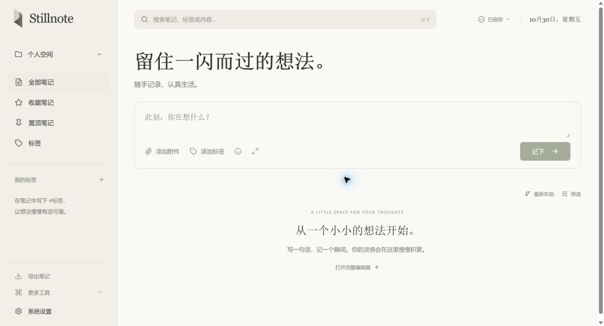
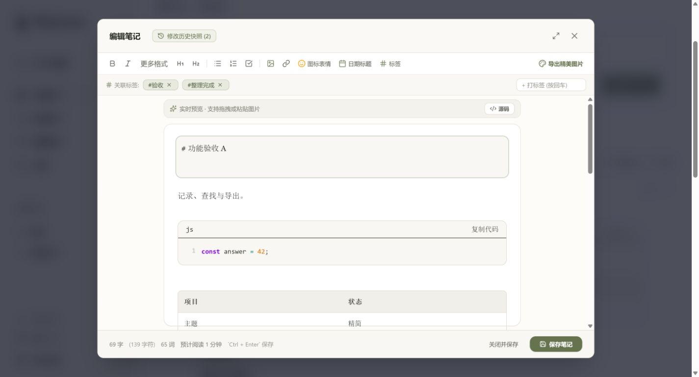
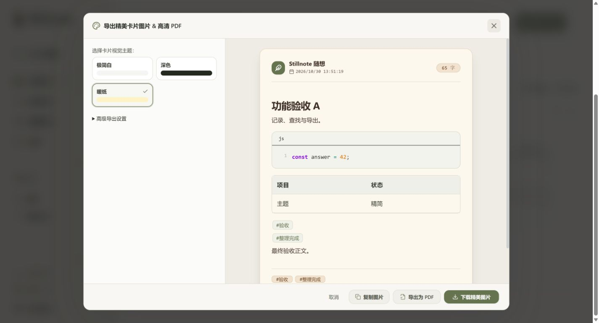
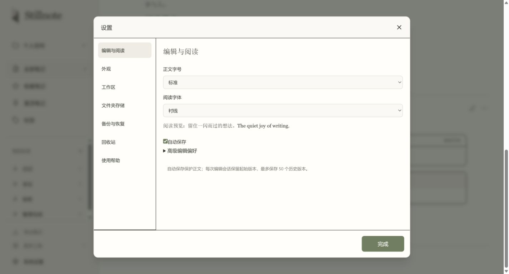
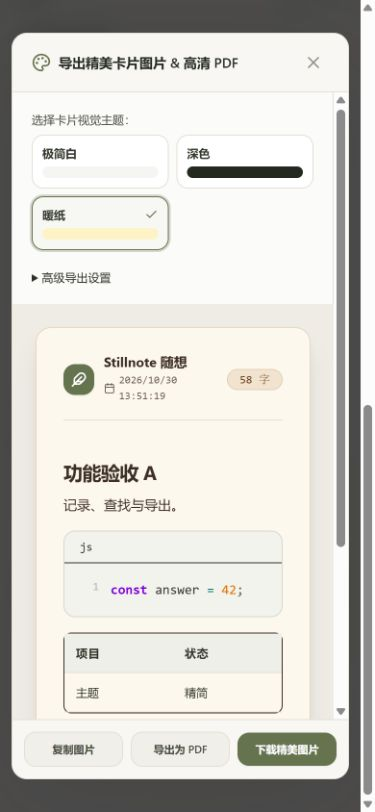

<div align="center">
  
  <h1>Stillnote</h1>
  <p><strong>留住一闪而过的想法。</strong></p>
  <p>A quiet, local-first Markdown notebook.</p>
  <p>
    <a href="https://github.com/Crazyer-Flove/Stillnote/releases/latest">下载 Windows 版</a> ·
    <a href="docs/user-guide.md">使用指南</a> ·
    <a href="docs/development.md">开发与打包</a> ·
    <a href="CHANGELOG.md">更新记录</a>
  </p>
  <p>  </p>
</div>

Stillnote（原 FloveNote）是一款本地优先的 Markdown 笔记工具。打开即可记录，通过工作区、标签和搜索整理内容，再导出为 Markdown、图片或 PDF。界面采用纸张色背景、克制的绿色和清晰的阅读层次，让日常记录保持轻松。

无需注册账号。Windows 桌面版内置应用资源，不需要安装 Node.js 或启动服务器；源码也支持在浏览器中运行。当前界面语言为中文。



## 下载与开始

前往 [Releases](https://github.com/Crazyer-Flove/Stillnote/releases/latest)，按使用方式选择：

| 文件 | 适合场景 |
| --- | --- |
| `Stillnote-1.0.1-Windows-x64-Portable.exe` | 下载后双击运行，无需安装 |
| `Stillnote-1.0.1-Windows-x64-Setup.exe` | 安装到指定目录，添加开始菜单入口 |
| `SHA256SUMS.txt` | 核对下载文件的 SHA-256 |

支持 Windows 10/11 x64。首次打开便携版需要解压内置运行时，可能稍慢。安装包采用当前用户安装，无需管理员权限。

**创建桌面快捷方式：** 打开「系统设置 → 外观」，在桌面应用区域点击「创建桌面快捷方式」。便携版快捷方式指向原始 EXE；移动或重命名 EXE 后，请重新创建。安装程序默认不创建桌面快捷方式。

当前发布未购买代码签名证书，EXE 没有数字签名。请从本仓库 Releases 下载并核对校验值；如系统提示风险，应先核验文件来源。

```powershell
Get-FileHash .\Stillnote-1.0.1-Windows-x64-Portable.exe -Algorithm SHA256
```

> 便携版表示免安装，并不表示数据保存在 EXE 旁边。桌面版数据位于 `%APPDATA%\Stillnote`。便携版与安装版共用此目录。备份是可靠迁移和恢复的必要步骤。

## 可以做什么

| 场景 | 功能 |
| --- | --- |
| 随手记录 | 快速输入、完整编辑器、日记/会议/读书三种模板、未完成草稿恢复 |
| Markdown 写作 | 即时预览、源码/分栏/预览模式、任务列表、表格、公式、代码高亮、图片 |
| 整理与查找 | 多工作区、层级标签、收藏、置顶、日期筛选、最近搜索与命名筛选 |
| 批量处理 | 对当前结果批量添加标签、移动工作区、导出 Markdown 或移入回收站 |
| 回看修改 | 按编辑会话保存历史起始快照，最多 50 个，查看差异和恢复版本 |
| 分享内容 | Markdown；高级格式中的 TXT/HTML；三种卡片主题，复制/下载图片与 PDF |
| 保存与迁移 | 本机保存状态、JSON 完整备份、导入预览、重复与冲突处理、可选文件夹写入 |
| 日常维护 | 回收站、资源引用检查、帮助说明、明暗模式和两种阅读字体 |

代码与表格样式随明暗模式自动适配，减少重复选项；卡片导出只保留极简白、暖纸、深色三种主题。正文写作和数据管理各有独立入口。

### 写作与阅读



支持常见 Markdown 与 GFM 语法、KaTeX 公式、图片拖放/粘贴和代码复制。已有笔记自动保存；新建模板先保留为草稿，明确保存后进入笔记库。保存失败会显示提示，请及时导出备份。

### 导出与设置



图片/PDF 面向阅读与分享，JSON 备份面向恢复。PDF 使用卡片图像排版，正文不是可编辑的文本 PDF；特别长的笔记和远程图片可能受内存、画布或跨域限制影响。

<details>
<summary>查看设置与移动端布局</summary>





截图使用演示笔记，来自浏览器功能验收；桌面版共用同一界面，另增加桌面应用信息和快捷方式按钮。
</details>

## 数据、备份与旧版迁移

- 笔记默认保存在当前浏览器配置或桌面应用配置中，不会自动同步到云端或其他设备。清除浏览器站点数据会丢失该配置中的本地记录。
- 桌面版与网页、不同浏览器、不同端口/域名是独立的数据空间。由旧版迁移时，先在原页面导出 JSON 备份，再在新版「系统设置 → 备份恢复」导入，并检查预览。
- 沿用旧版笔记存储键，兼容旧数组与 v2 JSON 备份；旧主题偏好会映射到精简后的样式。
- JSON 备份包含笔记、历史、笔记引用的本机图片、工作区及允许的偏好。**不包含独立图片资源库、文件夹授权、API Key、最近搜索、命名筛选和导出参数。** 远程图片仍是链接，不会自动离线打包。
- 文件夹存储需要用户主动选择并授权，每次重新打开应用可能需要重新授权。路径文本不等于已获得写入权限；写入前可预览，不会将任意同名文件直接覆盖。
- 本地数据没有额外的应用层加密；请结合操作系统账户和磁盘保护管理敏感笔记。

更多说明见 [使用与迁移指南](docs/user-guide.md)、[隐私说明](docs/privacy.md) 和 [安全策略](SECURITY.md)。

## 本地开发

需要 Node.js 22 LTS 与 npm。使用 npm 锁文件安装：

```bash
git clone https://github.com/Crazyer-Flove/Stillnote.git
cd Stillnote
npm ci
npm run dev
```

打开 `http://localhost:3000`。服务默认仅监听 `127.0.0.1`；可参考 `.env.example` 设置端口。

```bash
npm run lint          # TypeScript 检查
npm test              # 数据安全与功能回归
npm run build         # 前端及生产服务
npm start             # 启动生产服务
npm run desktop:dev   # 桌面开发预览
npm run desktop:build # Windows x64 便携版 + 安装版
```

Windows 构建产物位于 `release/`。桌面壳使用 Electron 的进程隔离、沙箱和受限 IPC；前端本地加载，不启动 Express 服务。详细结构、构建条件和发布流程见 [开发文档](docs/development.md)。

## 贡献与问题反馈

欢迎通过 [Issues](https://github.com/Crazyer-Flove/Stillnote/issues) 提交复现步骤和建议。提交前请阅读 [贡献指南](CONTRIBUTING.md)。请勿上传个人笔记、API Key、真实备份或含隐私的屏幕截图；安全问题请依照 [SECURITY.md](SECURITY.md) 报告。

## 致谢与许可

基于 React、TypeScript、Vite、Tailwind CSS、Electron、Lucide、react-markdown、Prism、KaTeX、html-to-image 和 jsPDF 等开源项目构建。第三方组件保留各自许可。

项目采用 [MIT License](LICENSE)，作者 Crazyer-Flove。欢迎使用、研究与改进。

<details>
<summary>赏赞作者</summary>

如果 Stillnote 对你有帮助，可以自愿支持后续维护。

| 微信 | 支付宝 |
| --- | --- |
|  |  |

</details>
